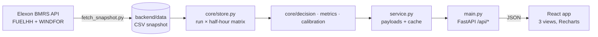

# Wind Forecast Monitor

A web app for a UK energy supplier's **day-ahead power purchasing team**. It shows:

1. **The latest national wind forecast available at decision time** (the day before delivery), with an
   uncertainty band, so the team knows how much power to buy beyond wind.
2. **How accurate that forecast has been**, measured in GW and broken down by lead time, decision time,
   time of day and day, so the team can buy with the error in mind.

Data: Elexon BMRS — actual wind generation ([FUELHH](https://bmrs.elexon.co.uk/api-documentation/endpoint/datasets/FUELHH/stream), fuel type `WIND`)
and wind forecasts ([WINDFOR](https://bmrs.elexon.co.uk/api-documentation/endpoint/datasets/WINDFOR/stream)), for purchase decisions made in **January 2026**.

**Live app:** https://44knzc.vercel.app · **Stack:** React + TypeScript (Vite, Recharts) · Python (FastAPI, pandas/numpy) · Docker · Vercel

---

## Key findings (January 2026)

| | |
|---|---|
| Error of the forecast available at 09:00 D-1 | **2.02 GW** mean absolute error (18% of average wind) |
| Direction | Forecast **too high in 85%** of half-hours, by +1.74 GW on average |
| Simple bias correction (no look-ahead) | Error falls to **1.49 GW (−27%)** |
| Waiting for the 11:30 forecast instead | Error falls only 7% |

Full write-up: [analysis/FINDINGS.md](analysis/FINDINGS.md) · reproduce with `python analysis/findings.py`.

---

## Quick start

### Option A: Docker (one command)

```bash
docker compose up --build
```

- App: http://localhost:8080
- API + interactive docs: http://localhost:8000/api/docs

### Option B: Local development

Requires Python ≥ 3.12 and Node ≥ 20.

```bash
# 1. Backend (terminal 1)
cd backend
python -m venv .venv
.venv/Scripts/activate        # Windows  (macOS/Linux: source .venv/bin/activate)
pip install -r requirements-dev.txt
uvicorn app.main:app --reload --port 8000

# 2. Frontend (terminal 2)
cd frontend
npm install
npm run dev                   # http://localhost:5173  (proxies /api to :8000)
```

### Tests and checks

```bash
cd backend  && pytest -q && ruff check . && mypy app
cd frontend && npm test && npm run lint && npm run build
```

### Refreshing the data

The app reads a snapshot in `backend/data/` (about 1 MB), so it is fast and never depends on Elexon
being up. To re-download it from Elexon:

```bash
cd backend && python -m scripts.fetch_snapshot
```

---

## Repository layout

```
.
├── backend/                     Python API
│   ├── app/
│   │   ├── main.py              FastAPI routes (thin HTTP layer, validation, OpenAPI docs)
│   │   ├── service.py           Use cases: builds API payloads from core calculations, caches results
│   │   ├── schemas.py           Pydantic response models (= API contract)
│   │   ├── config.py            Settings from environment variables (cutoff, date scope, CORS)
│   │   ├── elexon.py            Elexon BMRS client (chunked requests + retries)
│   │   └── core/                Pure domain logic, no web framework
│   │       ├── store.py         Loads data; puts every forecast run on the half-hour grid
│   │       ├── decision.py      "Forecast available at the D-1 cutoff" rule
│   │       ├── metrics.py       MAE, RMSE, bias, percentiles, by-hour / by-day breakdowns
│   │       └── calibration.py   Bias correction with no look-ahead
│   ├── data/                    January 2026 snapshot: actuals.csv, forecasts.csv, meta.json
│   ├── scripts/fetch_snapshot.py  Downloads the snapshot from Elexon
│   ├── tests/                   Unit tests (hand-made cases) + API tests (real snapshot)
│   ├── Dockerfile
│   ├── requirements.txt         Runtime dependencies (pinned)
│   ├── requirements-dev.txt     + test / lint / type-check tools
│   └── pyproject.toml           pytest, ruff and mypy settings
├── frontend/                    React app
│   ├── src/
│   │   ├── App.tsx              Shell: header, tabs, theme, URL-hash state
│   │   ├── api.ts               Typed API client (mirrors schemas.py)
│   │   ├── useApi.ts            Data-fetching hook with caching and request de-duplication
│   │   ├── format.ts            UK-time and number formatting, CSV export (+ format.test.ts)
│   │   ├── components/          Shared UI (cards, tiles, legend, tooltip) and chart theme
│   │   └── views/
│   │       ├── DecisionView.tsx   Day-ahead decision screen
│   │       ├── ExplorerView.tsx   Forecast vs actual over the month, any lead time
│   │       └── AccuracyView.tsx   Accuracy statistics and key findings
│   ├── Dockerfile               Build with Node, serve with nginx (+ /api proxy)
│   └── nginx.conf
├── api/index.py                 Vercel serverless entry point (wraps backend/app)
├── requirements.txt             Python deps for Vercel (same pins as backend/, checked by a test)
├── analysis/                    findings.py + FINDINGS.md (numbers quoted in the pitch)
├── docker-compose.yml           api (:8000) + web (:8080)
├── vercel.json                  Vercel build and routing
├── .github/workflows/ci.yml     Lint, type-check, test, build, Docker smoke test
└── .env.example                 Optional settings
```

---

## Architecture



- **Layers.** Routes → service → core. The `core` package is plain pandas/numpy with no web code, so
  the domain rules can be unit-tested directly.
- **Data model.** Each forecast run is interpolated onto the actuals' half-hour grid, giving a
  `runs × half-hours` matrix (280 × 1,536). "Latest run published before time X" then becomes a
  binary search, and every selection is vectorised. Once warm, every endpoint responds in under 0.5 s (cold start, including data load, is about 1 s).
- **Snapshot, not live calls.** The data is historical, so it is downloaded once and committed. This
  makes the app fast, reproducible and safe to deploy as a serverless function.
- **Caching.** Results are cached per process. Responses are also cached and de-duplicated in the browser.

### API

| Endpoint | Purpose |
|---|---|
| `GET /api/meta` | Delivery days in scope, forecast run schedule, snapshot time |
| `GET /api/decision?date=YYYY-MM-DD&cutoff=HH:MM` | Forecast available at the cutoff for each half-hour of day D, with P10/P90 band and actuals |
| `GET /api/timeseries?horizon=H&start&end` | Actual vs the newest forecast published ≥ H hours ahead |
| `GET /api/accuracy?mode=decision\|horizon` | Metrics, by-hour, by-day, error histogram, bias-correction benefit |
| `GET /api/accuracy/horizons` | Error vs lead time (0–48 h) |
| `GET /api/accuracy/cutoffs` | Error vs decision time (every 30 min on D-1) |

Interactive docs: `/api/docs`.

---

## Domain rules and data notes

| Topic | Decision |
|---|---|
| **Scope** | Decisions made 1–31 Jan 2026 → delivery days **2 Jan – 1 Feb 2026**. Forecasts published from 29 Dec 2025 are kept so that 48 h lead-time analysis works from the first day. |
| **Decision time** | Default **09:00 UK time on D-1**, before GB day-ahead auction gate closure (late morning). Adjustable in the UI (every 30 min) and via `DEFAULT_CUTOFF`. |
| **Forecast used** | The latest WINDFOR run with `publishTime ≤ cutoff`. Later runs are ignored, because the trader could not have seen them. A run published exactly at the cutoff counts. |
| **Run schedule** | About 8 runs a day (02:30, 04:30, 07:30, 09:30, 11:30, 15:30, 18:30, 22:30 UTC), each about 66 h ahead. At 09:00 the 07:30 run is used, covering D at 16.5–40 h lead time. |
| **Resolution** | Forecasts are hourly and actuals half-hourly. Forecasts are linearly interpolated within a run (exact on the hour, midpoint on the half-hour), never extrapolated or across gaps. |
| **Bad rows** | Forecast rows with `startTime < publishTime` are dropped (they are not forecasts). Duplicates are removed. |
| **Time zones** | Stored and computed in UTC. Delivery days and the cutoff are UK local (`Europe/London`), so 46- and 50-period clock-change days are handled. January is GMT, so UK time = UTC. |
| **Error sign** | `error = forecast − actual`. Positive = less wind than forecast = shortfall. |
| **Lead-time view** | For each half-hour, the newest forecast published ≥ H hours before it. |
| **Uncertainty band** | P10/P50/P90 of decision-time errors on the *other* January days (leave-one-day-out), subtracted from the forecast. "Expected" = forecast − median error. |
| **Bias correction metric** | Uses only days whose outturn was known at the decision (≤ D-2), so there is no look-ahead. |

---

## Development practices

- **Tests.** 19 backend tests: hand-made edge cases (cutoff boundaries, missing runs, interpolation,
  bad rows, clock-change days, sign convention, look-ahead) plus API tests on the real snapshot.
  Frontend: unit tests for formatting, UK time and CSV export.
- **Static checks.** `ruff` (lint + format), `mypy`, ESLint and a strict TypeScript build.
- **CI.** GitHub Actions runs all of the above, builds both Docker images and smoke-tests the
  running stack.
- **Reproducibility.** Pinned dependencies, a committed data snapshot, and the analysis numbers
  generated by a script.
- **UX and accessibility.** A colourblind-safe palette with light and dark themes, a legend on every
  multi-series chart, a table view and CSV export, shareable URLs, and a responsive layout down to
  phone width.

## Deployment (Vercel)

`vercel.json` (framework set to `vite`) builds the React app as static files and serves `api/index.py` (the FastAPI app plus the
data snapshot) as a Python serverless function under `/api/*`.

```bash
vercel --prod
```

## Limitations and next steps

- One winter month of data. Re-estimate the bias on a rolling window and check seasonality.
- Add demand and solar forecasts to show the residual volume to buy, not just wind.
- Replace the leave-one-day-out band with a rolling, lead-time-specific (or wind-level-specific)
  probabilistic model.
- Scheduled data refresh and alerts (e.g. "tomorrow is a high-wind day: the forecast is likely too high").
- Confirm with the client the cause of the systematic over-forecast (likely curtailment).

## Use of AI tools

This project was built with help from **Claude Code (Anthropic)**, used for research into the Elexon
APIs, code scaffolding and implementation, tests and documentation. All design decisions, data
handling rules and findings were reviewed and checked against the real data.
